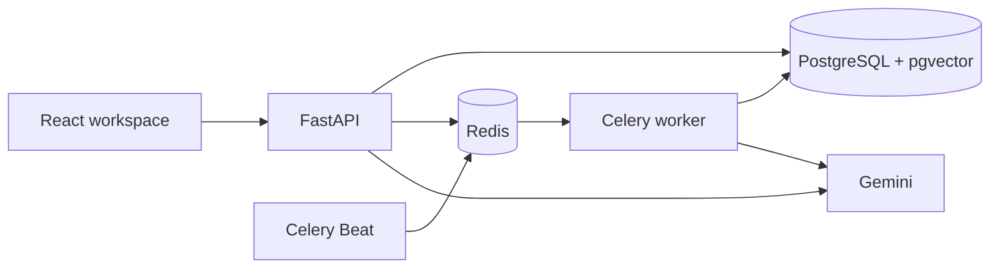

# Shion AI

[](https://github.com/thomacev/shion-AI/actions/workflows/ci.yml)

A document-assisted chat application built with **FastAPI, React, and Google Gemini**.
Create an assistant, upload PDFs or text files, and ask questions with document
citations. You can also use general knowledge, with answers clearly distinguishing
it from information in your files.

Shion AI is a learning and portfolio project focused on backend engineering and
practical retrieval-augmented generation (RAG), with a frontend for testing the
complete user flow.

## What you can do

- Register, sign in, and manage separate assistants with their own instructions.
- Upload PDF or UTF-8 TXT files and follow their processing status.
- Retry processing, download originals, and remove documents.
- Ask questions, read Markdown answers, and download cited source documents.
- Reopen saved conversations and change their answer mode.
- Use the workspace on desktop or mobile.

### Three answer modes

Choose **Answer using** above the message box:

| Mode | Behavior |
| --- | --- |
| **Documents + general knowledge** | Searches your documents and can supplement with clearly separated general explanations. Works without uploads. Default for new chats in the UI. |
| **Documents only** | Answers from retrieved document evidence. Without supporting evidence, says it cannot answer from the documents. The UI requires a ready document before sending. |
| **General knowledge** | Talks directly to Gemini without searching your documents. |

General knowledge is **not an internet search**. The application has no web-search
integration. New answers save their source labels and citations, so switching
modes does not relabel earlier messages. Historical messages without this metadata
display “Source information not recorded.”

Document citations identify retrieved references; they do not independently prove
that every claim is correct.

## Run locally

The current setup uses **Docker for the backend** and **npm for the frontend**.
There is no frontend service in Docker Compose.

### Prerequisites

- Docker with Docker Compose.
- Node.js 24 and npm for the frontend; Node 24 is used in the local workflow.
- A Gemini API key with access to the configured chat and embedding models.
- Python 3.12+ only if running backend tooling or tests outside Docker.

### 1. Clone and configure

```bash
git clone https://github.com/thomacev/shion-AI.git
cd shion-AI
cp .env.example .env
```

Edit the root `.env` before starting:

| Setting | Local setup |
| --- | --- |
| `GEMINI_API_KEY` | Replace the example with your real API key. |
| `SECRET_KEY` | Replace the placeholder with a long, random secret. |
| `POSTGRES_USER`, `POSTGRES_PASSWORD`, `POSTGRES_DB` | Choose your local database credentials. Keep `DATABASE_URL` consistent when using host-side Python tools. |
| `MODEL_NAME`, `EMBEDDING_MODEL` | Select models available to your key. The example uses `gemini-3-flash-preview` and `gemini-embedding-001`. |
| `EMBEDDING_DIM` | Keep `1536`; settings and the database schema currently require it. |
| `DEBUG` | Keep `true` for local HTTP cookie authentication. |

The example disables rate limiting for development. Model names are configurable;
the example is not a guarantee of model availability. Gemini keys stay in the
backend, never in frontend `VITE_*` variables.

### 2. Start the backend

```bash
docker compose up -d --build
docker compose ps
```

This starts PostgreSQL with pgvector, Redis, the FastAPI API, a Celery worker, and
the Celery Beat scheduler. The API entrypoint applies Alembic migrations before
starting the server. The worker processes uploads; the scheduler recovers pending
or expired processing work.

### 3. Start the frontend

In another terminal, from the repository root:

```bash
npm --prefix frontend ci
npm --prefix frontend run dev
```

Use **npm**, not `npx`, to run the `dev` script. Installing the root npm package is
not required for the frontend.

| Local service | Address |
| --- | --- |
| Frontend | [localhost:5173](http://localhost:5173), or the address Vite prints |
| API documentation | [localhost:8000/docs](http://localhost:8000/docs) |
| API health | [localhost:8000/health](http://localhost:8000/health) |

No frontend environment file is needed for the default setup. Vite forwards
`/auth` and `/assistants` to `http://127.0.0.1:8000`. Optional overrides are
documented in [frontend/.env.example](frontend/.env.example). Leave `VITE_API_URL`
empty to use that proxy; API routes do not have an `/api/v1` prefix.

### 4. Try the complete flow

1. Create an account and an assistant.
2. Ask a general question before uploading anything.
3. Upload a small text-based PDF or UTF-8 TXT file and wait for **Ready**.
4. Ask about a fact in the file; inspect the cited source.
5. Switch to **Documents only** and ask something the file does not cover.
6. Reopen the conversation, then sign out and sign back in.

For example, upload a file containing “Support is available Monday–Friday,
09:00–18:00.” Ask “When is support available?” and then “Explain what a support
window means” to compare document evidence with a general explanation.

### Logs and shutdown

```bash
docker compose logs -f api worker scheduler
```

Stop the frontend with `Ctrl+C`. Stop backend containers with:

```bash
docker compose down
```

The database remains in its named volume. Adding `-v` removes that volume and its
data.

## Stack and architecture

| Area | Technologies |
| --- | --- |
| Frontend | React, TypeScript, Vite, Tailwind CSS, Axios, React Markdown |
| API | Python 3.12+, FastAPI, Pydantic, async SQLAlchemy/asyncpg |
| Storage | PostgreSQL 15 with pgvector, Alembic migrations |
| AI | Google Gemini through `google-genai`, chat and embedding adapters |
| Background work | Celery worker, Celery Beat scheduler, Redis |
| Authentication | Argon2 password hashes, JWTs, HTTP-only cookies, Redis-backed login sessions |
| Validation | pytest/pytest-asyncio, Ruff, ESLint, TypeScript build, Playwright |
| Operations | Docker Compose, structured logging, request IDs, Prometheus metrics |



Uploads are saved before queue dispatch. Workers claim eligible documents, extract
text, create embeddings, and store searchable chunks with page metadata. Query
retrieval is scoped to the selected assistant's ready documents.

See [ARCHITECTURE.md](docs/ARCHITECTURE.md) for component boundaries, recovery,
authentication, answer policies, and data flows.

## Validation and CI

[TESTING.md](docs/TESTING.md) owns the validation commands and test setup, including
the disposable PostgreSQL/Redis requirements for backend tests.

Backend tests use real PostgreSQL/pgvector and mocked Gemini calls. Browser tests
simulate API responses. These checks cover application behavior; they do not
establish live model quality or end-to-end Celery delivery.

GitHub Actions runs on pushes and pull requests targeting `develop` and `main`.
It applies migrations, runs Ruff and pytest with a minimum 70% coverage, then
builds the backend Docker image. Frontend checks are currently run locally and
are not part of that workflow.

## Deployment boundaries

The checked-in Docker image packages the backend. A deployment also needs
PostgreSQL/pgvector, Redis, the worker, and the scheduler.

Build the frontend for static hosting using the command in
[TESTING.md](docs/TESTING.md#frontend-commands). Production needs a reverse proxy
for the API paths or a compatible API origin with explicit CORS and cookie
configuration. The Vite development proxy is not part of the production bundle
or the preview server. Use HTTPS and `DEBUG=false` outside local development.

## Current limitations

- PDF extraction has no OCR; scanned-only and encrypted PDFs are unsupported.
- Uploads support PDF and UTF-8 TXT only. The default file limit is 10 MiB.
- Answers arrive as complete responses, without token streaming.
- Model context includes up to 20 recent messages, further trimmed for the prompt
  budget; there is no long-term conversation summarization.
- Retrieval uses a configurable distance threshold without a systematic RAG
  evaluation dataset in the repository.
- Source validation checks format and reference IDs, not semantic correctness.
  General knowledge can be outdated.
- No web search, autonomous agent loop, or external tool execution is implemented.
- `/health` is a liveness response, not a dependency-readiness check.

## Documentation

| Document | Purpose |
| --- | --- |
| [Architecture](docs/ARCHITECTURE.md) | Components, persistence, ingestion, authentication, and chat behavior |
| [Testing](docs/TESTING.md) | Setup, validation commands, mocks, migration checks, and test boundaries |
| [Frontend](frontend/README.md) | Frontend entry points and development notes |
| [Agent guidance](AGENTS.md) | Repository conventions and links for coding agents |
