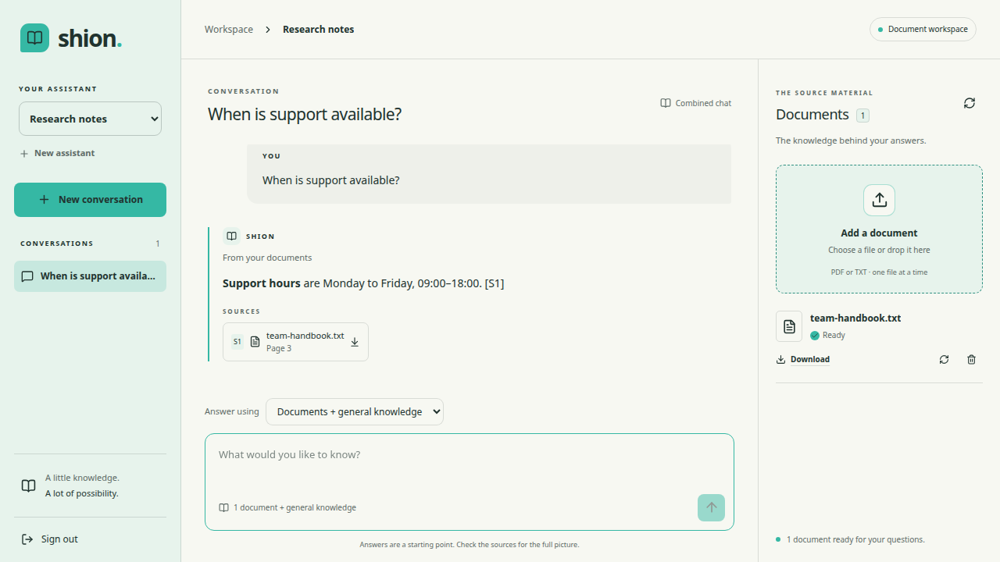
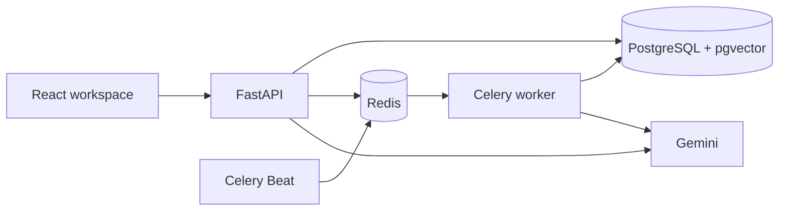

# Shion AI

### Document chat with visible sources and recoverable background processing.

[](https://github.com/thomacev/shion-AI/actions/workflows/ci.yml)
[](pyproject.toml)
[](src/app/app.py)
[](src/app/models/document.py)
[](src/app/core/gemini_client.py)
[](src/app/tasks/document_tasks.py)
[](src/app/core/redis.py)

[](frontend/package.json)
[](frontend/src/api/workspace.ts)
[](frontend/vite.config.ts)
[](frontend/src/index.css)
[](docker-compose.yml)
[](docs/TESTING.md)

**Upload documents, ask questions, and see which parts of an answer come from your
files or from general knowledge.** Shion AI combines a FastAPI backend, a React
workspace, and Google Gemini for chat and embeddings.

The project focuses on **Python backend engineering and applied AI**: asynchronous
jobs, database consistency, user isolation, retrieval, provider failures, and
testable API boundaries. The frontend makes the complete workflow accessible
without using API tooling.

[Product](#the-user-experience) · [Engineering](#engineering-highlights) ·
[Architecture](#stack-and-architecture) · [Tests](#validation-and-ci) ·
[Run locally](#run-locally)



*Actual workspace captured by the browser test suite with synthetic API responses
and sample document metadata. This preview illustrates the UI, not a live Gemini response.*

## The user experience

Create an account and an assistant, upload PDF or UTF-8 TXT files, and watch their
processing status. Ask questions, inspect citations, download originals, and
reopen saved conversations. Failed documents can be retried from the same
workspace. The layout supports desktop and mobile.

The **Answer using** selector makes the answer policy explicit:

| Mode | Behavior |
| --- | --- |
| **Documents + general knowledge** | Searches uploaded files and separates supporting evidence from general explanations. Works without uploads; default for new UI conversations. |
| **Documents only** | Answers from retrieved sources and declines when evidence is missing. Requires a ready document in the UI. |
| **General knowledge** | Uses Gemini without searching uploaded files. |

Each new answer saves its source label and cited references. Changing a
conversation's mode does not rewrite earlier labels. General knowledge is
explicitly marked **“no web search”**; browsing is not implemented.

## Engineering highlights

| Engineering concern | Implementation | Code to inspect |
| --- | --- | --- |
| **Work surviving dispatch failures** | Save uploads before queue publication. A scheduled recovery task finds pending or expired jobs and republishes eligible work. | [Document service](src/app/services/document_service.py), [Celery tasks](src/app/tasks/document_tasks.py) |
| **Safe repeated processing** | Atomic claims, expiring leases, guarded writes, and a unique chunk index prevent stale workers from overwriting newer processing results. | [Processing service](src/app/services/document_service.py), [persistence model](src/app/models/document.py) |
| **Reliable vector storage** | Validate embedding count, dimension, finite values, and nonzero vectors before marking documents ready. Retrieval checks embedding provenance. | [Embedding adapter](src/app/services/embedding_service.py), [regression tests](src/app/tests/test_document_tasks.py) |
| **Explicit answer provenance** | Structured combined answers separate document text from general explanations. The backend checks citation IDs and derives persisted source labels. | [Answer grounding](src/app/services/answer_grounding.py), [answer-mode tests](src/app/tests/test_answer_modes.py) |
| **User and session isolation** | Ownership checks scope resources to their users. Access and refresh tokens share a revocable Redis-backed login session. | [Security](src/app/core/security.py), [auth tests](src/app/tests/test_auth.py) |
| **Bounded external calls** | Provider deadlines, selective transient retries, prompt budgets, and generation claims limit stalled or overlapping work. | [Gemini client](src/app/core/gemini_client.py), [conversation service](src/app/services/conversation_service.py) |

These mechanisms have explicit limits: recovery depends on the worker and
scheduler running, and valid citation IDs do not prove a claim's semantic
correctness. The [architecture guide](docs/ARCHITECTURE.md) documents those
boundaries alongside the implementation.

## Stack and architecture

| Area | Technologies |
| --- | --- |
| Frontend | React, TypeScript, Vite, Tailwind CSS, Axios, React Markdown |
| API | Python 3.12+, FastAPI, Pydantic, async SQLAlchemy/asyncpg |
| Storage | PostgreSQL 15 with pgvector, Alembic migrations |
| AI | Google Gemini through `google-genai`, chat and embedding adapters |
| Background work | Celery worker, Celery Beat scheduler, Redis |
| Authentication | Argon2 password hashes, JWTs, HTTP-only cookies, Redis-backed login sessions |
| Validation | pytest/pytest-asyncio, Ruff, ESLint, TypeScript build, Playwright |
| Operations | Docker Compose, structured logging, request IDs, Prometheus metrics |



Uploads are saved before queue dispatch. Workers claim eligible documents, extract
text, create embeddings, and store searchable chunks with page metadata. Query
retrieval is scoped to the selected assistant's ready documents.

See [ARCHITECTURE.md](docs/ARCHITECTURE.md) for component boundaries, recovery,
authentication, answer policies, and data flows.

## Validation and CI

Testing is split by boundary so failures can be reproduced without depending on
live model responses:

| Layer | What is exercised |
| --- | --- |
| **Backend integration** | Real PostgreSQL/pgvector and Redis; API behavior, ownership, persisted state, document recovery and answer modes |
| **Provider boundary** | Mocked Gemini responses; retry behavior, output validation, token limits and structured-output configuration |
| **Browser flows** | Playwright with simulated API responses; registration, uploads, chat/history, session refresh, source labels and mobile navigation |
| **CI gates** | Alembic upgrade, Ruff, pytest with a 70% minimum coverage threshold, then the backend Docker build |

[Backend tests](src/app/tests) · [Browser tests](frontend/tests/workspace.spec.ts) ·
[CI workflow](.github/workflows/ci.yml) · [Validation commands](docs/TESTING.md)

GitHub Actions runs on pushes and pull requests targeting `develop` and `main`.
Frontend build, lint and browser checks currently run locally. Mocked-provider
and browser tests do not establish live Gemini quality or end-to-end Celery
message delivery. Backend test fixtures require disposable databases; see the
[isolated setup](docs/TESTING.md#isolated-backend-test-setup) before running them.

## Design tradeoffs and next steps

- **PostgreSQL stores both application data and original documents.** This keeps
  ownership, source downloads, and persistence together. Moving large originals
  to object storage is a possible next step as storage requirements grow.
- **The RAG pipeline uses direct service code and the Gemini SDK.** Extraction,
  retrieval, prompt construction, and source validation remain visible and
  independently testable without an agent framework.
- **Recovery uses database state plus periodic queue dispatch.** This handles
  interrupted work while keeping the system small; it is not exactly-once
  message delivery.
- **General knowledge is an explicit mode.** It supports questions beyond the
  uploaded files while keeping document-only behavior available.
- **Evaluation is the next AI-quality milestone.** Retrieval has a configurable
  threshold, but no systematic evaluation dataset yet. Useful next measurements
  include retrieval relevance, citation support, and correct abstention.

Current scope: text-based PDF and UTF-8 TXT uploads, complete-response chat, and
up to 20 recent messages within a prompt budget. OCR, streaming, long-term
summaries, web search, and autonomous tool execution are not implemented.
The default upload limit is 10 MiB. `/health` checks API liveness, not dependency
readiness.

## Run locally

<details>
<summary><strong>Setup, configuration, and walkthrough</strong></summary>

The current setup uses **Docker for the backend** and **npm for the frontend**.
There is no frontend service in Docker Compose.

### Prerequisites

- Docker with Docker Compose.
- Node.js 24 and npm for the frontend; Node 24 is used in the local workflow.
- A Gemini API key with access to the configured chat and embedding models.
- Python 3.12+ only if running backend tooling or tests outside Docker.

### 1. Clone and configure

```bash
git clone https://github.com/thomacev/shion-AI.git
cd shion-AI
cp .env.example .env
```

Edit the root `.env` before starting:

| Setting | Local setup |
| --- | --- |
| `GEMINI_API_KEY` | Replace the example with your real API key. |
| `SECRET_KEY` | Replace the placeholder with a long, random secret. |
| `POSTGRES_USER`, `POSTGRES_PASSWORD`, `POSTGRES_DB` | Choose your local database credentials. Keep `DATABASE_URL` consistent when using host-side Python tools. |
| `MODEL_NAME`, `EMBEDDING_MODEL` | Select models available to your key. The example uses `gemini-3-flash-preview` and `gemini-embedding-001`. |
| `EMBEDDING_DIM` | Keep `1536`; settings and the database schema currently require it. |
| `DEBUG` | Keep `true` for local HTTP cookie authentication. |

The example disables rate limiting for development. Model names are configurable;
the example is not a guarantee of model availability. Gemini keys stay in the
backend, never in frontend `VITE_*` variables.

### 2. Start the backend

```bash
docker compose up -d --build
docker compose ps
```

This starts PostgreSQL with pgvector, Redis, the FastAPI API, a Celery worker, and
the Celery Beat scheduler. The API entrypoint applies Alembic migrations before
starting the server. The worker processes uploads; the scheduler recovers pending
or expired processing work.

### 3. Start the frontend

In another terminal, from the repository root:

```bash
npm --prefix frontend ci
npm --prefix frontend run dev
```

Use **npm**, not `npx`, to run the `dev` script. Installing the root npm package is
not required for the frontend.

| Local service | Address |
| --- | --- |
| Frontend | [localhost:5173](http://localhost:5173), or the address Vite prints |
| API documentation | [localhost:8000/docs](http://localhost:8000/docs) |
| API health | [localhost:8000/health](http://localhost:8000/health) |

No frontend environment file is needed for the default setup. Vite forwards
`/auth` and `/assistants` to `http://127.0.0.1:8000`. Optional overrides are
documented in [frontend/.env.example](frontend/.env.example). Leave `VITE_API_URL`
empty to use that proxy; API routes do not have an `/api/v1` prefix.

### 4. Try the complete flow

1. Create an account and an assistant.
2. Ask a general question before uploading anything.
3. Upload a small text-based PDF or UTF-8 TXT file and wait for **Ready**.
4. Ask about a fact in the file; inspect the cited source.
5. Switch to **Documents only** and ask something the file does not cover.
6. Reopen the conversation, then sign out and sign back in.

For example, upload a file containing “Support is available Monday–Friday,
09:00–18:00.” Ask “When is support available?” and then “Explain what a support
window means” to compare document evidence with a general explanation.

### Logs and shutdown

```bash
docker compose logs -f api worker scheduler
```

Stop the frontend with `Ctrl+C`. Stop backend containers with:

```bash
docker compose down
```

The database remains in its named volume. Adding `-v` removes that volume and its
data.

</details>

## Deployment boundaries

The checked-in Docker image packages the backend. A deployment also needs
PostgreSQL/pgvector, Redis, the worker, and the scheduler.

Build the frontend for static hosting using the command in
[TESTING.md](docs/TESTING.md#frontend-commands). Production needs a reverse proxy
for the API paths or a compatible API origin with explicit CORS and cookie
configuration. The Vite development proxy is not part of the production bundle
or the preview server. Use HTTPS and `DEBUG=false` outside local development.

## Documentation

| Document | Purpose |
| --- | --- |
| [Architecture](docs/ARCHITECTURE.md) | Components, persistence, ingestion, authentication, and chat behavior |
| [Testing](docs/TESTING.md) | Setup, validation commands, mocks, migration checks, and test boundaries |
| [Frontend](frontend/README.md) | Frontend entry points and development notes |
| [Agent guidance](AGENTS.md) | Repository conventions and links for coding agents |
